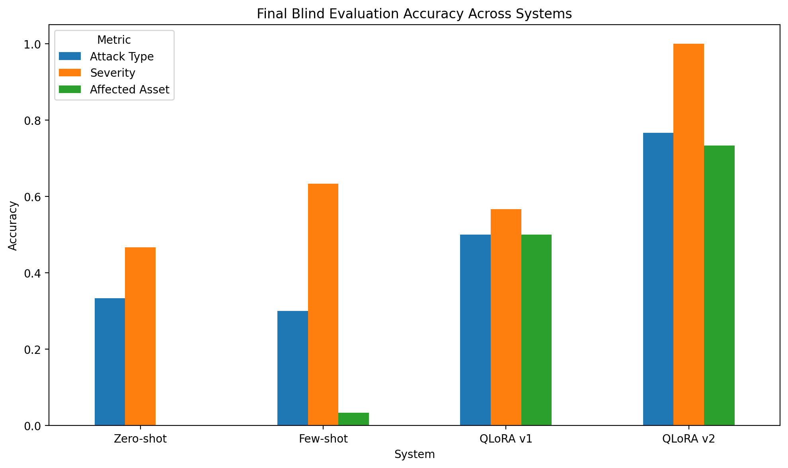

# QLoRA Fine-Tuning for Cybersecurity Threat Analysis JSON Generation

[](https://colab.research.google.com/github/RuchaPanhale/qlora-cybersecurity-threat-analysis/blob/main/qlora_cyber_threat_json_project.ipynb)

Fine-tuning a small open-weight LLM (**Qwen2.5-1.5B-Instruct**) with **QLoRA** to turn cybersecurity event descriptions into structured, schema-valid threat-analysis JSON. The fine-tuned model is compared against zero-shot and few-shot prompting of the same base model on a separate blind evaluation set.

## Highlights (final blind evaluation, 30 examples)

| System | Attack type accuracy | Severity accuracy | Affected asset accuracy | Schema valid |
|---|---:|---:|---:|---:|
| Base model, zero-shot | 33.3% | 46.7% | 0.0% | 0.0% |
| Base model, few-shot | 30.0% | 63.3% | 3.3% | 100.0% |
| QLoRA v1 | 50.0% | 56.7% | 50.0% | 100.0% |
| **QLoRA v2** | **76.7%** | **100.0%** | **73.3%** | **100.0%** |

- Only **~9.23M of ~1.55B parameters (~0.6%)** were trained, using LoRA adapters on a 4-bit quantized base model.
- Each training run took **~31–35 minutes** on a single Colab T4 GPU.
- A 20-question capability regression check showed **no measured drop** in unrelated reasoning or instruction-following after fine-tuning.



---

## Task

**Input:** a cybersecurity event description (a network-flow summary or a short incident report).

**Output:** JSON with exactly these keys:

```json
{
  "attack_type": "dos",
  "severity": "critical",
  "affected_asset": "web_service",
  "recommended_action": "Enable rate limiting or DDoS protection, block abusive sources, and monitor service availability.",
  "confidence": 0.9
}
```

- `attack_type`: one of `benign`, `generic_attack`, `exploit`, `dos`, `reconnaissance`, `fuzzing`, `analysis`, `backdoor`, `shellcode`, `worm`, `unknown`
- `severity`: one of `low`, `medium`, `high`, `critical`
- `affected_asset`: normalized asset label (e.g., `web_service`, `dns_service`, `network_service`, `network_host`)
- `recommended_action`: free-text response recommendation
- `confidence`: number between 0 and 1

---

## Dataset Construction

**Source:** UNSW-NB15 network intrusion dataset (Moustafa & Slay, UNSW Canberra), via the Kaggle mirror [`harshwardhanbhangale/unsw-complete-dataset`](https://www.kaggle.com/datasets/harshwardhanbhangale/unsw-complete-dataset). The raw data has **2,540,047** network-flow rows.

**Pipeline (all in the notebook):**

1. Loaded the four raw UNSW-NB15 CSV files and attached the official column names from the features file.
2. Cleaned whitespace and inconsistent category labels (e.g., `Backdoor` / `Backdoors`).
3. Mapped categories to the project taxonomy; rows with a missing category were labeled `benign`.
4. Sampled a class-balanced subset: 300 rows per class (150 for `worm`), giving **2,850** examples across 10 classes.
5. Converted each row into a templated natural-language description (protocol, service, IPs/ports, connection state, duration, bytes, packets).
6. Generated JSON targets with transparent rules (below).
7. Made a stratified 85/15 train/dev split by `attack_type` (seed 42): **2,422 train / 428 dev**.

**Labeling rules:**

| Field | Rule |
|---|---|
| `attack_type` | Mapped from the UNSW-NB15 attack category |
| `severity` | `benign` → low; `worm`, `backdoor`, `shellcode` → critical; `exploit`, `dos` → high; `generic_attack`, `reconnaissance`, `analysis`, `fuzzing` → medium |
| `affected_asset` | HTTP/HTTPS or port 80/443 → `web_service`; FTP or 20/21 → `ftp_service`; SMTP or 25 → `mail_server`; DNS or 53 → `dns_service`; SSH or 22 → `ssh_service`; IRC → `irc_service`; other TCP/UDP → `network_service`; otherwise `network_host` |
| `recommended_action` | Attack-type-specific response template that includes the asset |
| `confidence` | Fixed value per class group: 0.84 (benign), 0.86 (recon/fuzzing/analysis), 0.88 (generic/exploit/dos), 0.90 (backdoor/shellcode/worm) |

### Dataset sizes

| Split | Examples |
|---|---:|
| Curated v1 total | 2,850 |
| Train v1 | 2,422 |
| Dev v1 | 428 |
| Train v2 (v1 + targeted augmentation) | 2,614 |
| Manual iteration eval (hand-written) | 30 |
| Final blind eval (hand-written) | 30 |

---

## Model and Training

**Base model:** `Qwen/Qwen2.5-1.5B-Instruct`

**Quantization (QLoRA):** 4-bit NF4 with double quantization and fp16 compute dtype (bitsandbytes).

**LoRA configuration:**

| Setting | Value |
|---|---|
| Rank (r) / alpha / dropout | 8 / 16 / 0.05 |
| Target modules | `q_proj`, `k_proj`, `v_proj`, `o_proj`, `gate_proj`, `up_proj`, `down_proj` |
| Trainable parameters | ~9.23M of ~1.55B (~0.6%) |

**Training setup (Hugging Face `Trainer`):**

| Setting | v1 | v2 |
|---|---|---|
| Starting point | Base model + new LoRA adapter | Continued from the v1 adapter |
| Training data | Train v1 (2,422) | Train v2 (2,614) |
| Learning rate | 2e-4 | 1e-4 |
| Epochs | 1 | 1 |
| Batch size × gradient accumulation | 1 × 8 | 1 × 8 |
| Other | warmup 20 steps, weight decay 0.01, max length 768, fp16, `paged_adamw_8bit`, gradient checkpointing | same |
| Training time (Colab T4) | ~31 min | ~35 min |
| Final dev loss | 0.1186 | 0.1127 |

The prompt uses a fixed system instruction listing the required keys and allowed values, wrapped in plain-text `<|system|>`, `<|user|>`, `<|assistant|>` tags.

---

## Evaluation Design

**Systems compared:**
1. Base model, zero-shot (instructions only)
2. Base model, few-shot (instructions plus 5 demonstrations taken from the training set)
3. QLoRA v1
4. QLoRA v2

All systems use greedy decoding with up to 180 new tokens.

**Two hand-written evaluation sets:**
- **Manual iteration set (30):** used during development. QLoRA v1 errors on this set guided the v2 changes.
- **Final blind set (30):** written *after* v2 was finalized and not used for any design decisions. **This is the main reported result.** No blind example duplicates a training example.

**Metrics:**

| Metric | Definition |
|---|---|
| JSON valid | A JSON object could be parsed from the output. The scorer extracts the first `{...}` block, so output wrapped in markdown code fences still counts. |
| Schema valid | All 5 keys present, `attack_type` and `severity` use allowed values, `recommended_action` is a string, and `confidence` is a number in [0, 1] |
| Attack type / severity / asset accuracy | Exact match with the expected label |
| Numeric confidence | `confidence` can be converted to a number |

`recommended_action` is not scored.

---

## Results

### Manual iteration evaluation (used during development)

| System | JSON Valid | Schema Valid | Attack Acc. | Severity Acc. | Asset Acc. | Numeric Conf. |
|---|---:|---:|---:|---:|---:|---:|
| Base zero-shot | 1.00 | 0.00 | 0.433 | 0.500 | 0.000 | 0.00 |
| Base few-shot | 1.00 | 1.00 | 0.233 | 0.600 | 0.133 | 1.00 |
| QLoRA v1 | 1.00 | 1.00 | 0.667 | 0.633 | 0.567 | 1.00 |
| QLoRA v2 | 1.00 | 1.00 | 0.900 | 1.000 | 0.800 | 1.00 |

Because this set informed v2, these numbers are iteration results, not the final result.

### Final blind evaluation (main result)

| System | JSON Valid | Schema Valid | Attack Acc. | Severity Acc. | Asset Acc. | Numeric Conf. |
|---|---:|---:|---:|---:|---:|---:|
| Base zero-shot | 1.00 | 0.00 | 0.333 | 0.467 | 0.000 | 0.00 |
| Base few-shot | 1.00 | 1.00 | 0.300 | 0.633 | 0.033 | 1.00 |
| QLoRA v1 | 1.00 | 1.00 | 0.500 | 0.567 | 0.500 | 1.00 |
| QLoRA v2 | 1.00 | 1.00 | 0.767 | 1.000 | 0.733 | 1.00 |

**Observations:**
- Zero-shot output looked like JSON but never matched the schema. For example, it gave confidence as `"95%"` or `"medium"`, and assets as free text like `"web portal"`.
- Few-shot fixed the format but not the project-specific labels, especially `affected_asset`.
- QLoRA v1 learned the schema and taxonomy. QLoRA v2 gave the best results on every field.
- QLoRA v2's remaining errors were mostly in `fuzzing` (0/3 correct), `analysis` (0/2) and `exploit` (1/3), usually predicted as `reconnaissance` or `dos`.

---

## v1 Failure Analysis → v2

On the manual iteration set, 21 of 30 QLoRA v1 outputs had at least one field wrong. Confusion matrices (saved in `results/`) showed that:

- `worm` was always predicted as `dos` (3/3)
- `backdoor` was sometimes predicted as `benign`
- `critical` severity was often downgraded to `high` or `low`
- Asset labels were reasonable but not normalized (e.g., `public_website` instead of `web_service`)
- `network_service` and `network_host` were often confused

**v2 change (data only):** I wrote **16 targeted examples** covering worm, backdoor, generic attack, reconnaissance, benign, exploit and DoS cases, with normalized asset labels. I oversampled them 12× (192 rows), added them to the v1 training set (2,614 total), and continued training from the v1 adapter at a lower learning rate. The base model, prompt, schema and metrics stayed the same, so the improvement can be attributed to the data change.

---

## Capability Regression Check

To check whether fine-tuning harmed unrelated abilities, I compared the base model (the same model with the adapter turned off) and QLoRA v2 on 20 hand-written questions: 10 reasoning/arithmetic and 10 instruction-following. Scoring uses normalized exact match and a "contains the expected answer" check (max 60 new tokens).

| System | Category | Exact Match | Contains Expected |
|---|---|---:|---:|
| Base model | Reasoning / arithmetic | 0.60 | 0.90 |
| Base model | Instruction following | 0.40 | 0.50 |
| QLoRA v2 | Reasoning / arithmetic | 0.80 | 0.90 |
| QLoRA v2 | Instruction following | 0.70 | 0.80 |
| **Base model** | **Overall (20)** | **0.50** | **0.70** |
| **QLoRA v2** | **Overall (20)** | **0.75** | **0.85** |

No regression was measured on this small set. The gain is likely because the fine-tuned model gives shorter, more direct answers. This is not evidence of broader capability improvement.

---

## Repository Structure

```
├── qlora_cyber_threat_json_project.ipynb   # Full pipeline: data, baselines, training, evaluation, plots
├── PROJECT_REPORT.md                       # Course write-up
├── data/processed/
│   ├── dataset_summary_v1.json             # Dataset statistics and construction steps
│   ├── train_v1.jsonl, dev_v1.jsonl        # Curated train/dev splits
│   ├── train_v2.jsonl                      # v1 train + targeted augmentation
│   ├── manual_eval.jsonl                   # 30-example manual iteration set
│   ├── final_blind_eval.jsonl              # 30-example final blind set
│   └── *_sft.jsonl                         # Same data formatted as prompt + target text
└── results/
    ├── final_blind_model_comparison.csv/.json   # Main results
    ├── final_blind_all_results.csv              # Per-example blind predictions
    ├── final_model_comparison.csv               # Manual iteration results
    ├── zero_shot_*, few_shot_*, lora_v1_*, lora_v2_*   # Per-system results and summaries
    ├── lora_v1_*_confusion.csv, lora_v1_failures.csv, v1_failure_analysis_notes.json
    ├── regression_*.csv                         # Capability regression results
    ├── training_logs_v1/v2.csv/.json            # Training and dev loss logs
    ├── final_experiment_summary.json            # All key numbers in one file
    └── plots/                                   # Accuracy, regression and loss plots
```

**Trained adapters are not included** because of file size. They can be reproduced by running the notebook.

---

## How to Run

1. Click **Open in Colab** at the top of this README.
2. Set the runtime to a GPU: **Runtime → Change runtime type → T4 GPU**.
3. Run the cells in order. The notebook installs its dependencies (`transformers`, `peft`, `bitsandbytes`, `datasets`, `accelerate`, `kagglehub`, `pandas`, `scikit-learn`), downloads UNSW-NB15 with `kagglehub`, and writes outputs to `/content/qlora-cyber-threat-json/`.

The notebook was developed interactively across several Colab sessions. It contains optional Google Drive backup/restore cells used between sessions, which can be skipped if you run everything in one session.

---

## Limitations

- **Small evaluation sets:** both evaluation sets have 30 examples, so one example equals 3.3 percentage points. The results show clear differences between systems but are not precise estimates.
- **Label leakage in the templated training data:** each generated description for an attack row ends with *"The event was associated with {attack_type} activity,"* so the model can partly copy the label from the input. The hand-written evaluation sets do not contain this sentence, so they measure performance without the shortcut. The dev loss, however, is computed on templated data and is therefore optimistic.
- **Severity rule mismatch:** the training rules map `dos` to `high`, but the hand-written evaluation sets label DoS cases as `critical` (as does the v2 augmentation example).
- **Rule-based labels:** `severity`, `affected_asset`, `recommended_action` and `confidence` come from heuristics, not analyst annotations. `confidence` is a fixed value per class, not a calibrated probability.
- **Single author:** the evaluation sets and the v2 augmentation were all hand-written by the same author.
- **Prompt and loss setup:** prompts use plain-text role tags rather than Qwen's native chat template, and the training loss covers the full prompt plus answer rather than the answer only.
- **Small regression check:** 20 questions in 2 categories, not a general benchmark.

## Future Work

- Remove the label sentence from the templated descriptions, unify the severity rules, and retrain.
- Use the Qwen chat template and answer-only loss for all systems.
- Expand the blind set to 100+ varied examples, and report per-class precision, recall, macro-F1 and confidence intervals.
- Add targeted examples for `fuzzing`, `analysis` and `exploit`.
- Score `recommended_action`, e.g. with LLM-as-a-judge.
- Publish the adapters on the Hugging Face Hub, and add `requirements.txt`, an inference script and a demo.

## Acknowledgments

- UNSW-NB15 dataset: N. Moustafa and J. Slay, *"UNSW-NB15: a comprehensive data set for network intrusion detection systems,"* MilCIS 2015.
- Base model: [Qwen2.5-1.5B-Instruct](https://huggingface.co/Qwen/Qwen2.5-1.5B-Instruct) by the Qwen team.
- Built with Hugging Face Transformers, PEFT, Datasets and bitsandbytes.
